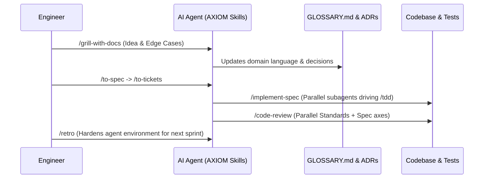

# AXIOM® — Technical Architecture

This document explains how **AXIOM®** (`annoris/axiom`) structures its **106 AI Agent Skills** (`68` Engineering · `28` Productivity · `10` Dependencies) and powers the **Interactive Next.js 15 Live Explorer** (`https://annoris.github.io/axiom/`).

---

## 1. Execution Model: User-Invoked vs. Model-Invoked

Every skill in the full AXIOM pack is a focused Markdown specification (`SKILL.md`) with YAML frontmatter controlling invocation scope:

```yaml
---
name: grill-with-docs
description: Stateful requirements interview that updates GLOSSARY.md and ADRs inline.
disable-model-invocation: true
---
```

| Invocation Mode | Frontmatter | Architectural Role |
| :--- | :--- | :--- |
| **User-Invoked** | `disable-model-invocation: true` | **Workflow orchestrators** called directly by the engineer (e.g. `/ask-axiom`, `/grill-with-docs`, `/implement-spec`, `/security-audit`). May call model-invoked skills, never another user-invoked one. |
| **Model-Invoked** | `disable-model-invocation: false` | **Reusable engineering disciplines** callable manually *or* invoked automatically by the agent when relevant (e.g. `/tdd`, `/code-review`, `/sql-optimizer`, `/lockfile-doctor`). |

---

## 2. Composable Engineering Flow



---

## 3. Next.js 15 Live Interactive Explorer

The live showcase at [`annoris.github.io/axiom`](https://annoris.github.io/axiom/) is engineered with:

- **Next.js 15 + React 19**: Static-export friendly catalog rendering all **106 skills** with zero server overhead.
- **GSAP + InertiaPlugin + ScrollTrigger**: Powers kinetic showcase cards, elastic cursor bubbles, radial origin-scaled navbar popouts, and footer sticker proximity physics.
- **Lenis Smooth Scroll**: Synchronizes damped scroll inertia with adaptive `.on-dark` / `.on-light` header contrast.
- **Instant Search &amp; 1-Click Copy**: Filter by **All (106)**, **Engineering (68)**, **Productivity (28)**, or **Dependencies (10)** and copy any `/slug` command immediately.

---

> 🔒 Want to unlock the complete **106 `SKILL.md` pack + Next.js 15 source code**? See **[`CONTRIBUTING.md`](./CONTRIBUTING.md)**.
