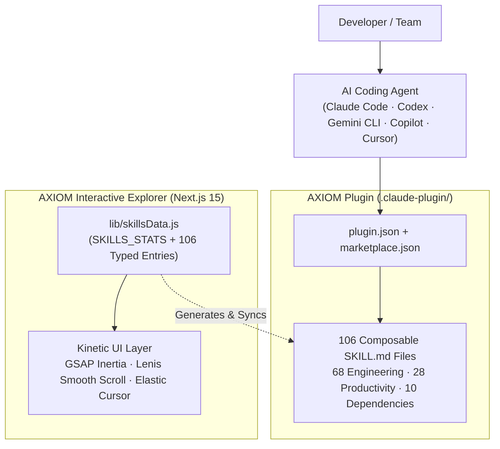

  

  <h1>AXIOM® — 106 Battle-Tested AI Agent Skills</h1>

  

    <strong>Precision over Vibe Coding — 106 Battle-Tested AI Agent Skills (68 Engineering · 28 Productivity · 10 Dependencies) for Claude Code, OpenAI Codex, Gemini CLI, GitHub Copilot &amp; Cursor.</strong>
  

  

    <em>106 Skills de ingeniería real para agentes de IA · Cero vibe coding · Live Explorer en Next.js 15 + Modelo Contribute-to-Unlock</em>
  

  

    
    &nbsp;
    
  

  

    
    
    
     
    
    
    
    
    
  

  

    <a href="#-explore-all-106-skills-catalog">Browse All 106 Skills</a> ·
    <a href="#-why-axiom-beats-vibe-coding">Why AXIOM</a> ·
    <a href="#-architecture">Architecture</a> ·
    <a href="#-contribute-to-unlock-the-full-106-skill-pack--nextjs-15-source">Unlock Full Pack</a>
  

---

  
   
  <h3>⭐ Stop Vibe Coding. Star <code>annoris/axiom</code> &amp; explore the 106-skill catalog live!</h3>
  <em>Explora la web interactiva en <a href="https://annoris.github.io/axiom/">annoris.github.io/axiom</a> y revisa el catálogo completo de 106 comandos abajo.</em>

 

  

---

## 🔥 Explore All 106 Skills Catalog

Every AXIOM skill is a focused, composable `SKILL.md` engineered for **Claude Code**, **OpenAI Codex**, **Gemini CLI**, **GitHub Copilot**, **Cursor**, and **Windsurf**. Click any category to inspect all **106 commands**:

| Category | Skills | Highlights |
| :--- | :---: | :--- |
| **Engineering** | **68** | Grilling, Specs/Tickets, Parallel Subagents, TDD, Debugging, Security, DB Migrations, Perf, WebGL, SRE |
| **Productivity** | **28** | Handoffs, RFCs, ADRs, Decision Matrices, Scope Cutting, Eval Harnesses, Prompt Debugging |
| **Dependencies** | **10** | Supply-Chain Audits, Major Upgrades, Lockfile Doctor, Peer Deps, Licenses, CVEs, Tree-Shaking, SBOMs |

<strong>⚙️ Engineering Skills (68) — Click to expand / collapse</strong>

 

| Command | Mode | What it does |
| :--- | :---: | :--- |
| `/ask-axiom` | User | Smart router across all 106 skills for your exact situation |
| `/grill-with-docs` | User | Stateful requirements interview updating `GLOSSARY.md` &amp; ADRs inline |
| `/triage` | User | Moves raw bugs &amp; requests through canonical triage roles |
| `/improve-codebase-architecture` | User | Scans for deep-module refactors &amp; outputs a visual HTML report |
| `/setup-axiom-skills` | User | One-time repo setup for tracker, labels, and domain docs |
| `/to-spec` | User | Synthesizes a grilling thread into a buildable spec |
| `/to-tickets` | User | Splits any spec into vertical tracer-bullet tickets with blocking edges |
| `/implement` | User | Drives `/tdd` at pre-agreed seams and closes with `/code-review` |
| `/implement-spec` | User | Parallel implementer subagents across a ticket task graph |
| `/wayfinder` | User | Charts multi-session foggy efforts as a shared decision map |
| `/retro` | User | Post-session retro that hardens agent steering files &amp; checks |
| `/prototype` | Model | Throwaway runnable prototypes to settle state/UI questions empirically |
| `/diagnosing-bugs` | Model | Gated debug loop: red repro → minimize → hypothesize → fix → regression test |
| `/research` | Model | Background primary-source research captured as a cited Markdown brief |
| `/tdd` | Model | Red-green-refactor vertical slices with strict test discipline |
| `/domain-modeling` | Model | Sharpens ubiquitous domain language &amp; records durable ADRs |
| `/codebase-design` | Model | Deep-module vocabulary: rich behaviour behind clean, small interfaces |
| `/code-review` | Model | Parallel two-axis diff review (**Standards** + **Spec** adherence) |
| `/pr` | Model | Concise PR body with minimal visuals, before/after proof &amp; blast radius |
| `/wizard` | Model | Interactive bash wizards for human-only steps (secrets, cloud dashboards) |
| `/api-contract` | Model | Versioned, backward-compatible HTTP/RPC contracts &amp; error envelopes |
| `/db-migration` | User | Expand-and-contract zero-downtime migrations with lock analysis |
| `/perf-profiler` | Model | Flamegraph &amp; waterfall profiling before targeted optimization |
| `/security-audit` | User | OWASP Top 10, auth boundaries, injection &amp; privilege escalation audit |
| `/ci-pipeline` | User | Fast, cached CI workflows with deterministic test sharding |
| `/docker-hardening` | Model | Multi-stage, non-root, pinned-digest minimal container images |
| `/k8s-manifest` | Model | Production K8s manifests with probes, PDBs, HPA &amp; resource limits |
| `/graphql-schema` | Model | Relay-compliant schemas with DataLoader batching &amp; safe deprecations |
| `/edge-caching` | Model | CDN Cache-Control, stale-while-revalidate &amp; surrogate key rules |
| `/observability` | User | Structured logs, RED/USE metrics &amp; SLO-backed alerting |
| `/incident-postmortem` | User | Blameless postmortems with timeline &amp; systemic action items |
| `/load-testing` | User | Realistic k6/Artillery stress profiles &amp; tail-latency cliffs |
| `/auth-flows` | Model | OAuth2/OIDC, PKCE, session rotation, RBAC/ABAC &amp; CSRF guards |
| `/state-machine` | Model | Replaces tangled boolean flags with exhaustive finite state machines |
| `/design-tokens` | Model | Semantic CSS custom properties for color, typography &amp; motion |
| `/a11y-audit` | User | WCAG 2.2 AA audit: focus traps, ARIA, contrast &amp; reduced motion |
| `/web-vitals` | Model | Optimizes LCP, INP, and CLS with priority hints &amp; layout reservation |
| `/ssr-hydration` | Model | Eliminates React/Next.js hydration mismatches &amp; server waterfalls |
| `/monorepo-graph` | User | Workspace DAG mapping, circular import fixes &amp; Turborepo caching |
| `/feature-flags` | Model | Typed rollout flags, kill switches &amp; dead-flag cleanup plans |
| `/rate-limiting` | Model | Token-bucket &amp; sliding-window limiters with fair tenant quotas |
| `/event-sourcing` | Model | Append-only domain event streams, projections &amp; snapshots |
| `/cqrs-blueprint` | Model | Clean write-command vs denormalized read-model separation |
| `/webhook-verifier` | Model | Constant-time HMAC verification, replay checks &amp; async handoff |
| `/zero-downtime-deploy` | User | Blue-green/canary checklists with graceful SIGTERM draining |
| `/chaos-drills` | User | Controlled fault-injection game days for timeouts &amp; circuit breakers |
| `/sql-optimizer` | Model | `EXPLAIN ANALYZE` tuning, composite indexes &amp; join rewrites |
| `/memory-leak-hunt` | Model | Isolates retained closures, orphaned listeners &amp; heap growth |
| `/bundle-trimmer` | Model | Audits JS chunks &amp; adds dynamic route-level code splitting |
| `/type-narrowing` | Model | Eliminates `as any` with discriminated unions &amp; type predicates |
| `/error-taxonomy` | Model | Typed domain errors, HTTP mappings &amp; correlation IDs |
| `/openapi-sync` | Model | Keeps OpenAPI 3.1, Zod schemas &amp; TS SDKs in strict lockstep |
| `/e2e-playwright` | User | Flake-free Playwright journeys with role locators &amp; traces |
| `/visual-regression` | Model | Deterministic viewport screenshot baselines &amp; font-load gates |
| `/contract-testing` | Model | Consumer-driven contract tests across service/BFF boundaries |
| `/mutation-testing` | Model | Exposes weak test assertions using targeted code mutants |
| `/schema-evolution` | Model | Forward/backward-compatible JSON/Protobuf/Avro payload evolution |
| `/queue-workers` | Model | Resilient workers with visibility timeouts &amp; dead-letter queues |
| `/idempotency-guard` | Model | Atomic idempotency keys protecting mutating endpoints &amp; jobs |
| `/secret-scanner` | User | Diff/history secret scanning &amp; pre-commit leak prevention |
| `/csp-hardener` | Model | Strict CSP, HSTS &amp; Permissions-Policy headers with nonces |
| `/i18n-extractor` | Model | Extracts hardcoded UI strings into typed ICU message catalogs |
| `/seo-structured-data` | Model | Validated JSON-LD schemas, canonicals, OG cards &amp; sitemaps |
| `/webgl-shader-lint` | Model | Reviews GLSL shaders for precision, divergence &amp; GPU memory leaks |
| `/worker-offload` | Model | Moves heavy compute into Web Workers with transferable buffers |
| `/stream-backpressure` | Model | Bounded Node/Web Streams respecting `highWaterMark` |
| `/retry-backoff` | Model | Exponential backoff with full jitter, retry budgets &amp; circuit breakers |
| `/telemetry-spans` | Model | OpenTelemetry distributed tracing spans &amp; baggage propagation |

<strong>⚡ Productivity Skills (28) — Click to expand</strong>

 

| Command | Mode | What it does |
| :--- | :---: | :--- |
| `/grill-me` | User | Stateless relentless interview to resolve every branch of a plan |
| `/handoff` | User | Compacts a session into a portable Markdown handoff doc |
| `/teach` | User | Multi-session stateful workspace for mastering new concepts |
| `/to-questionnaire` | User | Turns external blockers into async stakeholder questionnaires |
| `/wait-what` | User | Mid-conversation clarity reset in plain English via `GLOSSARY.md` |
| `/grilling` | Model | Core interview primitive powering AXIOM's structured flows |
| `/writing-for-agents` | Model | Authoring standards for `SKILL.md`, `AGENTS.md` &amp; `CLAUDE.md` |
| `/daily-brief` | User | 60-second standup brief from open PRs, blockers &amp; git activity |
| `/rfc-writer` | User | Structured engineering RFCs with alternatives &amp; migration risks |
| `/adr-logger` | Model | Immutable Architecture Decision Records in `docs/adr/` |
| `/release-notes` | User | Turns merged PRs into human-readable user-impact release notes |
| `/changelog-curator` | Model | Keep-a-Changelog entries &amp; SemVer bump recommendations |
| `/meeting-distiller` | User | Extracts decisions, open questions &amp; owners from transcripts |
| `/stakeholder-update` | User | Executive-ready status updates highlighting risks &amp; milestones |
| `/onboarding-map` | User | Guided repo tour of entry points, invariants &amp; first-week tasks |
| `/runbook-builder` | User | Step-by-step operational runbooks with safe rollback commands |
| `/decision-matrix` | User | Weighted trade-off tables comparing viable technical paths |
| `/scope-cutter` | User | Carves bloated specs down to a sharp v1 vertical slice |
| `/roadmap-sequencer` | User | Sequences epics by dependency risk &amp; team parallelism |
| `/demo-script` | User | Tight 3-minute live demo narrative with fallback checkpoints |
| `/pr-narrative` | Model | Commit-by-commit reviewer walkthrough for large diffs |
| `/bug-repro-builder` | Model | Distills vague reports into deterministic repro steps |
| `/context-compactor` | Model | Lossless high-density state summary near token boundaries |
| `/prompt-debugger` | User | Diagnoses misfiring prompts/skills &amp; tightens constraints |
| `/eval-harness` | User | Golden test sets &amp; rubric graders for prompts and agent flows |
| `/knowledge-graph` | Model | Cross-links glossary terms, ADRs &amp; specs into a repo index |
| `/weekly-synthesis` | User | Weekly digest of shipped tickets, velocity &amp; friction |
| `/deep-work-planner` | User | Partitions complex engineering days into focused maker blocks |

<strong>📦 Dependencies Skills (10) — Click to expand</strong>

 

| Command | Mode | What it does |
| :--- | :---: | :--- |
| `/dep-audit` | User | Audits direct/transitive deps for abandonment &amp; supply-chain risk |
| `/upgrade-planner` | User | Phased major-version upgrade plans with codemods &amp; smoke checks |
| `/lockfile-doctor` | Model | Repairs corrupted lockfiles, duplicate hoists &amp; phantom deps |
| `/peer-dep-resolver` | Model | Resolves `ERESOLVE` peer dependency range conflicts cleanly |
| `/license-compliance` | User | Scans dependency trees for copyleft/restricted licenses |
| `/bundle-weight-check` | Model | Measures gzipped/brotli client cost &amp; suggests lighter swaps |
| `/cve-patch-triage` | User | Triages security advisories by real runtime reachability |
| `/tree-shake-audit` | Model | Exposes barrel-file side effects dragging dead code into bundles |
| `/esm-cjs-migrator` | User | Migrates packages cleanly between CJS and native ESM |
| `/sbom-generator` | User | Generates CycloneDX / SPDX SBOMs wired into release CI |

---

## 🎯 Why AXIOM Beats Vibe Coding (4 Pillars)

1. **Alignment Before Code (`/grill-with-docs`)**: Eliminates "the agent built the wrong thing" by grilling every edge case before touching a file.
2. **Ubiquitous Domain Language (`GLOSSARY.md`)**: Cuts token waste and verbosity so agents speak your exact architecture instead of 20-word circumlocutions.
3. **Tight Verification Loops (`/tdd` + `/diagnosing-bugs`)**: Every fix starts with a failing repro; every feature ships in red-green-refactor vertical slices.
4. **Anti-Entropy Architecture (`/codebase-design` + `/code-review`)**: Prevents AI-accelerated "ball of mud" codebases via deep modules and parallel two-axis PR reviews.

---

## 🧠 Architecture

> 📖 Dive into the User-Invoked vs. Model-Invoked execution model and Next.js 15 explorer architecture in **[`ARCHITECTURE.md`](./ARCHITECTURE.md)**.

---

## 🔒 Contribute-to-Unlock the Full 106-Skill Pack &amp; Next.js 15 Source

This public repository (**[`annoris/axiom`](https://github.com/annoris/axiom)**) lets you **explore the live interactive catalog ([`annoris.github.io/axiom`](https://annoris.github.io/axiom/)), study the architecture, and browse the visual vault in [`./axiom/`](./axiom/)**.

**The complete downloadable 106 `SKILL.md` pack and full Next.js 15 source code are not publicly exposed here.** They are unlocked exclusively for **approved contributors** who strengthen the community:

- 🛠️ **Submit a High-Signal Pull Request** in [`annoris/axiom`](https://github.com/annoris/axiom) (propose a new skill spec, improve `ARCHITECTURE.md` diagrams, add workflow playbooks, or contribute translations).
- 🧠 **Open a Detailed Technical Issue** in [`annoris/axiom/issues`](https://github.com/annoris/axiom/issues) (real-world agent failure modes, prompt hardening ideas, or Live Explorer UX audits).
- 🤝 **Direct Collaboration or Sponsorship** — reach out via **[`CONTRIBUTING.md`](./CONTRIBUTING.md)** with your GitHub handle.

👉 **Read [`CONTRIBUTING.md`](./CONTRIBUTING.md) for the exact step-by-step Contribute-to-Unlock process.**

---

## 📣 Share AXIOM®

Help other engineers ditch vibe coding for real agentic engineering:

  
  &nbsp;
  
  &nbsp;
  

 

  <strong>AXIOM® Engineering</strong> · Precision over Vibe Coding · <a href="https://axiom.dev">axiom.dev</a> · <a href="mailto:hello@axiom.dev">hello@axiom.dev</a>

